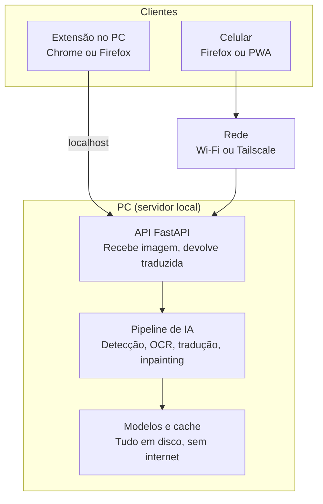
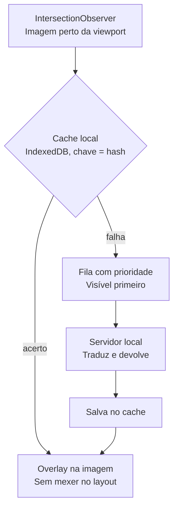
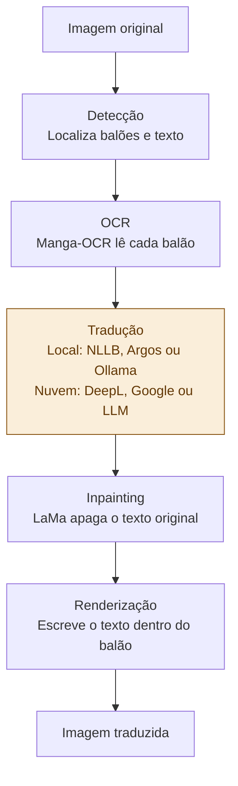

# Extensão de tradução de mangá em tempo real

Resumo da conversa sobre a viabilidade e a arquitetura de uma extensão de navegador que traduz o conteúdo da tela mantendo a formatação original (por exemplo, o texto dentro dos balões de fala de um mangá).

> Os diagramas usam Mermaid e aparecem renderizados no GitHub, no Obsidian e no VS Code (com extensão de Mermaid).

---

## 1. Objetivo

Criar uma extensão para navegador que traduza o que está na tela preservando ao máximo o formato original: em mangás, o texto traduzido deve aparecer dentro dos próprios balões. A tradução deve acontecer em tempo real enquanto a página é rolada, funcionar sem internet (com servidor e modelos locais) e também poder ser usada no celular, conectado ao PC.

## 2. Viabilidade

É possível, e já existem ferramentas que fazem algo parecido, como Manga Translator, Image Translator e o Google Lens integrado ao Chrome. A solução combina visão computacional (para achar e ler o texto), tradução e edição de imagem (para apagar o texto original e escrever o traduzido no mesmo lugar).

## 3. Pipeline de tradução de imagens

| Etapa | O que faz | Ferramentas |
|---|---|---|
| Captura | Obtém a imagem da página | ``, `<canvas>` ou screenshot da aba com `chrome.tabs.captureVisibleTab` |
| Detecção | Localiza balões e regiões de texto | comic-text-detector, YOLO treinado para balões |
| OCR | Lê o texto de cada região | Manga-OCR (japonês), Tesseract, Google Vision |
| Tradução | Traduz o texto extraído | DeepL, Google Translate ou um LLM (costuma ser melhor em diálogos e gírias) |
| Inpainting | Apaga o texto original e reconstrói o fundo | Pintar de branco (balões brancos) ou LaMa (fundos complexos) |
| Renderização | Escreve o texto traduzido dentro do balão | Canvas (ou Pillow no servidor), com quebra de linha e ajuste automático do tamanho da fonte |

Ao final, a imagem traduzida é colocada por cima da original.

### Páginas web comuns

Para texto normal da página (que não está em imagem), o processo é bem mais simples: percorrer os nós de texto do DOM, traduzir e substituir, mantendo o HTML intacto.

### Desafios principais

Os pontos mais difíceis são a qualidade do inpainting em fundos complexos, o texto vertical japonês e as fontes estilizadas (como onomatopeias), o custo e a latência quando se usam APIs na nuvem, e o problema de CORS ao ler no canvas imagens hospedadas em outros domínios. Rodar os modelos localmente elimina o custo de API, mas deixa a solução mais pesada.

---

## 4. Tradução em tempo real durante o scroll

A estratégia é traduzir apenas o que aparece na tela (ou está prestes a aparecer) e guardar o resultado.

| Mecanismo | Função |
|---|---|
| `IntersectionObserver` | Detecta quando uma imagem se aproxima da área visível (margem de 1 a 2 telas) e dispara a tradução antes de o usuário chegar nela |
| Fila com prioridade | A imagem visível agora é processada primeiro; as próximas ficam em pré-carregamento |
| Cache (IndexedDB) | Guarda o resultado pelo hash ou URL da imagem; ao voltar, a tradução aparece na hora, sem reprocessar |
| Overlay | Coloca a imagem traduzida por cima da original (ou troca o `src`), sem alterar o layout da página |
| `MutationObserver` | Para texto comum do DOM, traduz o conteúdo à medida que é carregado (praticamente instantâneo) |

### Latência

O que decide se a experiência parece "tempo real" é o tempo de processamento por imagem.

| Onde roda | Tempo por página de mangá | Observação |
|---|---|---|
| Nuvem com GPU | ~1 a 3 s | Com pré-carregamento, o atraso quase não é percebido |
| Dentro do navegador (ONNX/WebGPU) | ~3 a 10 s | Depende do PC; pré-carregamento é obrigatório |
| Servidor local sem GPU | ~5 a 15 s | Funciona, mas fica lento |

Para ganhar velocidade, processe apenas os balões e faça OCR e tradução em lote, em vez de uma chamada por balão.

Em scroll muito rápido, a tradução chega com um pequeno atraso. A solução é exibir a imagem original e trocá-la pela traduzida assim que ficar pronta.

---

## 5. Onde o processamento roda

A extensão sempre roda no navegador. A decisão é onde fica o processamento pesado (detecção, OCR, tradução e inpainting).

| | Opção A: extensão + servidor | Opção B: tudo no navegador |
|---|---|---|
| Como funciona | A extensão captura a imagem e envia a um servidor (no próprio PC ou na nuvem), que faz o trabalho pesado e devolve a imagem traduzida | Os modelos de IA rodam dentro da extensão com ONNX Runtime Web ou WebGPU |
| Vantagens | Mais rápido e mais fácil de construir, pois usa Python e GPU | Não precisa de servidor, funciona offline e não tem custo de API |
| Desvantagens | É preciso manter um servidor rodando | Mais lento, depende do PC, extensão pesada (modelos de centenas de MB) e desenvolvimento bem mais difícil |

**Recomendação:** começar pela opção A, com o servidor rodando no próprio PC (`localhost`), para validar a ideia rapidamente. Depois, se fizer sentido, migrar para a opção B.

---

## 6. Funcionamento offline

Com o servidor local, detecção, OCR e inpainting rodam 100% no PC, com os modelos baixados uma única vez.

A única etapa que pode exigir internet é a **tradução**, caso use DeepL, Google ou um LLM na nuvem. Para ficar totalmente offline, a tradução também deve ser local, usando Argos Translate, NLLB ou um LLM pequeno via Ollama.

---

## 7. Uso no celular conectado ao PC

O celular pode usar o mesmo servidor que roda no PC, mas a forma de acesso muda conforme a plataforma.

| Plataforma | Como fazer |
|---|---|
| Android | O Chrome para Android não aceita extensões. Use o Firefox para Android, que aceita. A extensão aponta para o IP do PC (ex.: `http://192.168.0.10:8000`) |
| iPhone | O Safari aceita extensões, mas o processo é mais trabalhoso: é preciso empacotar a extensão como app |
| Qualquer celular, sem extensão | O servidor do PC serve uma página web (PWA) que abre o mangá, traduz e exibe. Funciona em qualquer navegador e é a opção mais simples |

> Observação: o Kiwi Browser, citado na conversa como alternativa no Android, foi descontinuado em 2025. O Firefox para Android é a opção recomendada.

### Comunicação entre o celular e o PC

| Situação | Solução | Precisa de internet? |
|---|---|---|
| Mesma rede Wi-Fi | Acessar pelo IP local do PC | Não |
| Fora de casa | Usar o Tailscale (VPN gratuita e simples) para o celular enxergar o PC de qualquer lugar | Sim, no celular; o PC precisa estar ligado |

**Atenção ao hardware:** o PC precisa de uma GPU razoável para ficar rápido. Sem GPU, cada página pode levar de 5 a 15 segundos.

---

## 8. Arquitetura completa

### 8.1 Visão geral

No PC, a extensão se comunica direto com o servidor via `localhost`. O celular passa pela rede (Wi-Fi local ou Tailscale).

### 8.2 Fluxo interno da extensão

Se a imagem já foi traduzida antes, ela aparece na hora (cache). Caso contrário, entra na fila, vai ao servidor, e o resultado é salvo no cache antes de ser exibido.

### 8.3 Pipeline de IA no servidor

A etapa de tradução (destacada) é a única que pode usar internet, caso seja feita na nuvem.

---

## 9. Stack tecnológica

| Parte | Tecnologias |
|---|---|
| Extensão | Manifest V3, content script, `IntersectionObserver`, `MutationObserver`, IndexedDB |
| Servidor | Python com FastAPI |
| Detecção | comic-text-detector ou YOLO treinado para balões |
| OCR | Manga-OCR (japonês) ou Tesseract |
| Tradução | Local: NLLB, Argos Translate ou Ollama. Nuvem: DeepL, Google Translate ou LLM |
| Inpainting | LaMa (ou pintar de branco em balões simples) |
| Renderização | Canvas ou Pillow, com ajuste automático de fonte |
| Execução no navegador (opção B) | ONNX Runtime Web, WebGPU |
| Acesso pelo celular | Wi-Fi local ou Tailscale; Firefox para Android ou PWA |

---

## 10. Próximo passo

Montar o esqueleto do projeto, começando pelo servidor local (FastAPI com o pipeline) ou pela extensão (observer, fila e cache).
